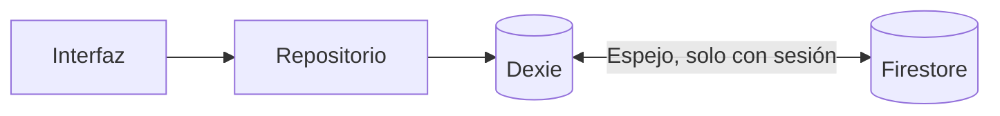

# Andamia

Gestor de tareas personal, con interfaz en español, que guarda los datos en tu navegador. No necesita cuenta ni servidor.

La especificación está en [docs/investigacion/](docs/investigacion/README.md).

## Instalar y ejecutar

Requiere Node.js 22 o superior.

```bash
npm install
```

```bash
npm run dev
```

Después abre <http://localhost:5173>.

## Comandos

| Comando | Qué hace |
|---|---|
| `npm run dev` | Inicia la app en modo desarrollo |
| `npm run build` | Revisa los tipos y genera la versión final en `dist/` |
| `npm run preview` | Sirve la versión de `dist/` |
| `npm test` | Ejecuta las pruebas de lógica |
| `npm run test:e2e` | Ejecuta los flujos de punta a punta; requiere Google Chrome instalado, y Java para los de Firebase |
| `npm run test:reglas` | Prueba las reglas de seguridad en el emulador de Firestore; requiere Java |
| `npm run emuladores` | Inicia los emuladores de Firebase |
| `npm run deploy` | Publica en Firebase Hosting; requiere tu proyecto configurado |

## Funciones

| Área | Incluye |
|---|---|
| Organización | Bandeja de entrada, listas con color, carpetas y etiquetas |
| Vistas | Todas, Hoy, Mañana, Próximos 7 días, Completadas, Papelera |
| Tareas | Título, notas, fecha y hora, cuatro prioridades, etiquetas y subtareas |
| Repetición | Diaria, semanal por días, mensual, anual, cada N o personalizada |
| Recordatorios | Uno o varios por tarea, con aviso del navegador y dentro de la app |
| Kanban | Columnas propias por lista, y arrastrar tareas entre ellas |
| Calendario | Vista de mes y de semana, arrastrar para cambiar la fecha, y panel de tareas sin fecha |
| Matriz de Eisenhower | Cuatro cuadrantes; arrastrar entre ellos cambia la prioridad |
| Enfoque | Pomodoro, cronómetro, registro de sesiones y estadísticas |
| Hábitos | Frecuencias, objetivo por día, rachas, historial, cumplimiento y recordatorio |
| Papelera | Las tareas borradas se pueden restaurar o eliminar para siempre |
| Búsqueda | En títulos, notas y subtareas, sin distinguir mayúsculas ni acentos, con filtros |
| Orden | Arrastrar con el ratón o con el teclado |
| Apariencia | Tema claro y oscuro; se adapta a móviles |

## Entrada rápida

Escribe la tarea y los datos en una sola línea. Antes de crearla verás lo que se reconoció.

```text
Enviar informe mañana 9am !alta #trabajo ~Oficina
```

| Dato | Ejemplos |
|---|---|
| Día | `hoy`, `mañana`, `pasado mañana`, `ayer`, `el viernes`, `en 3 días`, `en 2 semanas` |
| Fecha | `20 de diciembre`, `25/12` |
| Hora | `9am`, `9:30 pm`, `18:30`, `a las 10`, `a las 6 de la tarde` |
| Repetición | `cada día`, `cada lunes`, `todos los lunes`, `cada lunes y jueves`, `cada 2 semanas`, `cada mes`, `cada año`, `de lunes a viernes` |
| Prioridad | `!alta`, `!media`, `!baja`, `!ninguna` |
| Etiqueta | `#trabajo`; se crea si no existe |
| Lista | `~Oficina`; debe existir, y admite nombres con espacios |

Reglas:

- Un día de la semana es siempre su próxima ocurrencia: `lunes` dicho un lunes es dentro de 7 días.
- Una hora sin día es para hoy, o para mañana si ya pasó.
- La tarea se crea en la lista o vista abierta, salvo que el texto indique otra cosa.
- Una tarea con hora recibe un recordatorio a esa hora; puedes quitarlo en el detalle.
- Palabras sueltas como "mensual" no activan una repetición: hace falta "cada" o "todos los".

## Repetición

Al completar una tarea repetida ocurre lo siguiente:

- Queda una copia en Completadas, con la fecha y las subtareas de ese momento.
- La tarea sigue pendiente en su próxima fecha, con todas sus subtareas sin marcar.
- Si estaba atrasada, salta a la primera fecha desde hoy, manteniendo su ritmo.

En el detalle puedes elegir si la siguiente fecha se calcula desde la fecha de la tarea o desde el día en que la completas. Una repetición mensual del día 31 se salta los meses que no tienen ese día.

## Recordatorios

**Los avisos solo son fiables con la app abierta en una pestaña o ventana.** Con la app cerrada no están garantizados:

| Mecanismo | Cuándo funciona |
|---|---|
| Revisión periódica en segundo plano | Solo con la app instalada en Chrome o Edge. El navegador decide cuándo revisa, y puede tardar horas o no hacerlo |
| Avisos programados en el navegador | Solo en navegadores con esa función experimental, hoy casi ninguno |
| Al volver a abrir | Muestra lo vencido en las últimas 24 horas |
| Push con Cloud Messaging | El código está listo, pero el envío programado requiere Cloud Functions, que no están en el plan gratuito |

- La app revisa los recordatorios cada 20 segundos y al volver a su pestaña.
- El aviso siempre aparece dentro de la app. Para recibirlo también como notificación del navegador, pulsa **Activar avisos del navegador** en la barra lateral. El permiso solo se pide al pulsar ese botón.
- Si un aviso venció con la app cerrada, se muestra al abrirla, siempre que tenga menos de 24 horas.
- En tareas de todo el día, el aviso se calcula desde las 09:00.

## Kanban

Cada lista puede verse como **Lista** o **Kanban**, y recuerda su modo. Las columnas se crean, renombran y reordenan, y al borrar una eliges adónde pasan sus tareas. Las tareas se mueven con su asa, que aparece al pasar el ratón.

## Calendario

- La semana empieza en lunes.
- Arrastrar una tarea a otro día cambia su fecha y conserva su hora.
- En la vista de semana, arrastrar a una hora fija esa hora, y arrastrar a la fila superior la deja para todo el día.
- Un clic en un espacio libre crea una tarea con esa fecha.
- Arrastrar una tarea al panel **Sin fecha** le quita la fecha y la repetición.
- Las próximas fechas de una tarea repetida se ven atenuadas y no se pueden mover. Mueve la que está activa.

## Matriz de Eisenhower

Cada cuadrante corresponde a una prioridad:

| Cuadrante | Prioridad |
|---|---|
| Urgente e importante | Alta |
| Importante, no urgente | Media |
| Urgente, no importante | Baja |
| Ni urgente ni importante | Ninguna |

- Solo muestra tareas pendientes, primero las que vencen antes.
- Arrastrar una tarea a otro cuadrante cambia su prioridad.
- Una tarea añadida en un cuadrante toma su prioridad y los filtros activos.

## Enfoque

- **Pomodoro:** 25 minutos de enfoque, 5 de descanso y 15 de descanso largo cada 4. Se configura con el botón de ajustes.
- **Cronómetro:** corre libremente hasta que lo detienes y lo guardas.
- **Tarea:** cada sesión puede sumarse a una tarea. También puedes empezar con **Enfocar** en el detalle de la tarea.
- **Recargar:** el temporizador se calcula con marcas de tiempo, así que sobrevive a recargar o cerrar la página. Una sesión que venció con la app cerrada se registra a su hora prevista.
- **Saltar:** registra lo trabajado si llega a un minuto. **Abandonar** no registra nada.
- **Aviso de fin:** suena un tono generado en el navegador y aparece un aviso. Solo llega con la app abierta; si estaba cerrada, verás la sesión registrada al volver.

## Hábitos

- **Frecuencia:** cada día, días de la semana o N veces por semana.
- **Marcar:** un clic en un día recorre hecho, parcial, no hecho y sin marcar. Con un objetivo por día, como 8 vasos, se escribe la cantidad.
- **Racha:** un parcial no suma ni la rompe, y hoy sin marcar tampoco la rompe. Con N veces por semana se cuenta en semanas.
- **Cumplimiento:** un parcial vale la mitad.
- **Archivar:** oculta el hábito y conserva su historial. **Borrar** elimina también el historial.
- **Recordatorio:** avisa a la hora elegida si el hábito sigue pendiente ese día, solo con la app abierta.

## Atajos

| Tecla | Acción |
|---|---|
| `N` | Ir al campo de nueva tarea |
| `/` | Abrir la búsqueda |
| `Esc` | Cerrar el detalle o un diálogo |
| `Espacio` y flechas, sobre el asa de una tarea | Reordenar |

## Tus datos

**Sin cuenta:**

- Se guardan en IndexedDB, solo en este navegador y en este equipo.
- Borrar los datos del sitio en el navegador también borra tus tareas.
- Otro navegador u otra dirección, incluido otro puerto, ven una base de datos distinta.

**Con cuenta** (requiere configurar Firebase; la guía está en [docs/firebase-paso-a-paso.md](docs/firebase-paso-a-paso.md)):

- Firestore guarda tus datos bajo `users/{uid}`, y solo tu cuenta puede leerlos o escribirlos.
- La app sigue funcionando sin conexión y envía los cambios al reconectar.
- Si dos dispositivos cambian la misma tarea, **gana la última escritura que recibe el servidor, para la tarea completa**. No se combinan los campos.
- Los cambios se envían agrupados, 1,5 segundos después de dejar de editar.
- La primera vez que entras, la app ofrece copiar a la cuenta los datos que tenías sin cuenta. La copia original sigue en el navegador.
- Cerrar sesión deja de mostrar los datos de la cuenta. Puedes pedir que también se borre su copia en ese navegador.
- El tema y los ajustes del temporizador se sincronizan. El temporizador en curso no: es de cada dispositivo.

**Copia de seguridad:** en **Cuenta y ajustes** puedes descargar todo en un archivo JSON y restaurarlo. Restaurar reemplaza todos los datos, después de validar el archivo y pedir confirmación.

## Instalar como app

Andamia es una PWA: funciona sin conexión y se puede instalar. El service worker solo se activa en la versión final, no con `npm run dev`:

```bash
npm run build
```

```bash
npm run preview
```

Después abre <http://localhost:4173>. Esa dirección tiene su propia base de datos: para llevar tus datos de `localhost:5173`, usa la copia de seguridad.

## Arquitectura de datos



- La interfaz y el repositorio siempre trabajan sobre Dexie, con o sin cuenta.
- Cada cuenta tiene su propia base (`andamia-u-{uid}`), separada de la base sin cuenta (`andamia`).
- Con sesión, `src/datos/espejo.ts` mantiene esa base igual a Firestore en ambos sentidos. **Firestore manda**: lo que confirma el servidor siempre se aplica.
- Sin Firebase configurado, ese código ni siquiera se descarga.

## Estructura

| Carpeta | Contenido |
|---|---|
| `src/modelos` | Tipos de datos |
| `src/datos` | Base de datos, repositorio, estado de la app, espejo y conexión con Firebase |
| `src/sw.ts` | Service worker |
| `tests/reglas` | Pruebas de las reglas de seguridad |
| `firestore.rules` | Reglas de seguridad de Firestore |
| `src/logica` | Entrada rápida, vistas, búsqueda, fechas, repeticiones, recordatorios, columnas, calendario, matriz, enfoque, hábitos y rutas |
| `src/vistas` | Pantallas |
| `src/componentes` | Piezas de la interfaz |
| `tests/unit` | Pruebas de lógica |
| `tests/e2e` | Flujos de punta a punta |

## Pendiente

| Fase | Contenido |
|---|---|
| Requiere el plan de pago de Firebase | Avisos garantizados con la app cerrada, mediante Cloud Functions |
| Sin fase asignada | Resumen, filtros guardados, renombrar etiquetas, reordenar listas y subtareas, posponer avisos, vistas de día, año y agenda, cronograma, exportar datos, secciones y días objetivo de hábitos, y criterios personalizados en la matriz |
