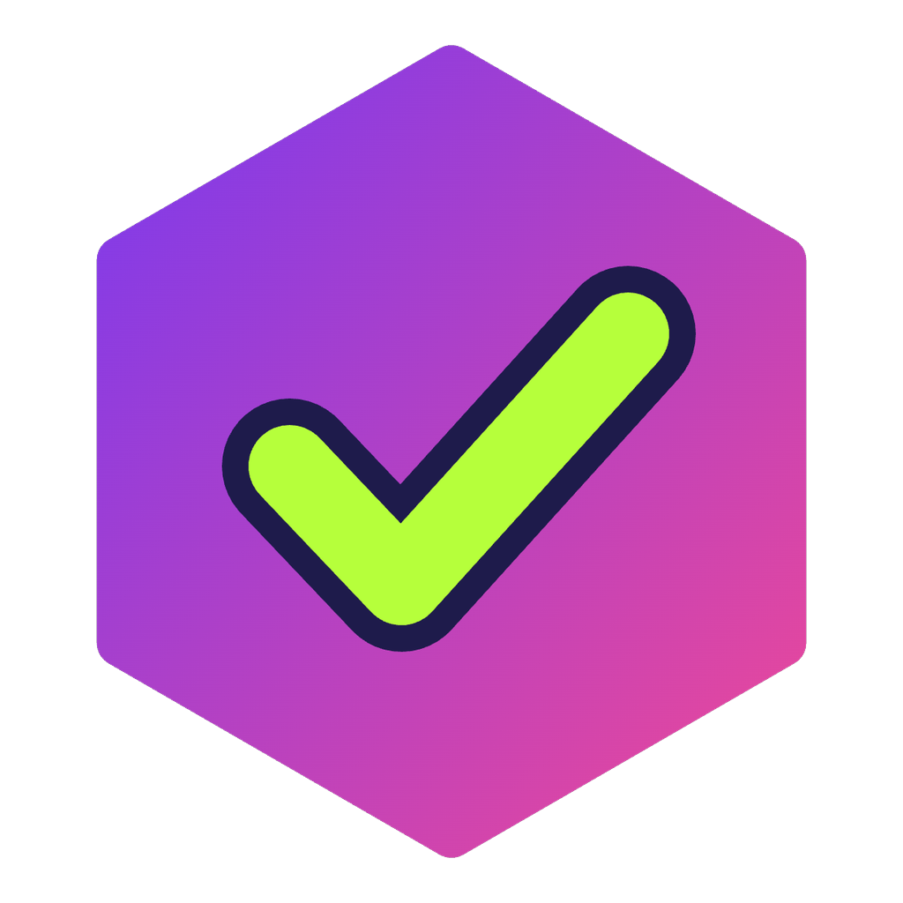
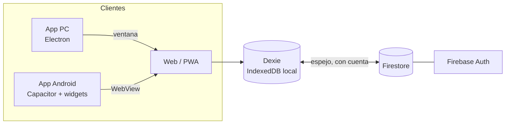

<p align="center">
  
</p>

<h1 align="center">Andamia</h1>

<p align="center">
  Gestor de tareas, hábitos y calendario en español.<br>
  Funciona en la web, en tu PC con Windows y en tu celular Android.
</p>

<p align="center">
  
  
  
  
</p>

---

## Video

Mira la app funcionando en el celular y en el PC: [▶️ Ver el video en YouTube](https://youtu.be/9WPnea_pqc0)
<!-- Pendiente: pegar aquí el enlace de YouTube -->

---

## Descripción

| Qué es | Dónde se guarda | Cuenta |
|---|---|---|
| Una app de tareas, listas, calendario y hábitos | En tu navegador (sin cuenta) o en Firebase (con cuenta) | Opcional |

## Características principales

| Área | Qué incluye |
|---|---|
| **Organización** | Bandeja de entrada, listas con color, carpetas y etiquetas |
| **Vistas** | Todas, Hoy, Mañana, Próximos 7 días, Completadas y Papelera |
| **Tareas** | Título, notas, fecha y hora, cuatro prioridades, etiquetas y subtareas |
| **Repetición** | Diaria, semanal por días, mensual, anual, cada N o personalizada |
| **Recordatorios** | Uno o varios por tarea; apagados por defecto (ver [Consideraciones](#consideraciones-importantes)) |
| **Kanban** | Columnas propias por lista, con tareas que se arrastran entre ellas |
| **Calendario** | Vista de mes y de semana, arrastrar para cambiar la fecha, y panel de tareas sin fecha |
| **Matriz de Eisenhower** | Cuatro cuadrantes; arrastrar entre ellos cambia la prioridad |
| **Hábitos** | Frecuencias, objetivo por día, rachas, historial, cumplimiento y confeti por hábito |
| **Búsqueda** | En títulos, notas y subtareas, sin distinguir mayúsculas ni acentos, con filtros |
| **Entrada rápida** | Una línea con fecha, hora, prioridad, etiqueta y lista |
| **Apariencia** | Temas, tema claro y oscuro, y se adapta a móviles |
| **Idioma** | Español o inglés (Cuenta y ajustes → Idioma); se guarda en cada dispositivo y cambia toda la app, sus fechas y los widgets del celular |

## Apps y dónde descargarlas

| App | Qué es | Dónde está | Cómo se actualiza |
|---|---|---|---|
| **Web** | La versión en el navegador | [andamia-85eab.web.app](https://andamia-85eab.web.app) | Se publica con `npm run deploy` |
| **PC (Windows)** | La web en su propia ventana, con bandeja, atajo y modo widget | Instalador `Andamia-Instalador-<versión>.exe` en la sección **Releases** del repositorio (etiqueta `escritorio`) | Se actualiza sola al cambiar la web; el instalador solo cambia si cambia `escritorio/` |
| **Android** | La web dentro de la app, con widgets para la pantalla de inicio | Archivo `Andamia-Android.apk` en la rama `apk-descargas` o en *Artifacts* de la acción **App de Android** | Instalar el `.apk` nuevo encima del anterior; los datos no se pierden |

> **Nota:** la app de Android no usa el service worker ni el botón "Instalar"; el resto de la web es igual.

### App de PC (Windows)

| Función | Detalle |
|---|---|
| Bandeja | Cerrar la ventana la esconde junto al reloj; "Salir" la cierra |
| Atajo global | **Ctrl + Alt + N** abre "Hoy" con el cursor en "Añadir tarea" |
| Modo escritorio | Ventana chica con "Hoy", detrás de las demás; vuelve tras Windows + D |
| Modo mini | Ventana chica, siempre encima, en la esquina inferior derecha |
| Inicio con Windows | Opción para arrancar escondida en la bandeja |
| Ventana angosta | Menú colapsado con ☰ y la barra superior con el color del tema |

### App de Android

| Función | Detalle |
|---|---|
| Widgets | Hoy, Semana, Matriz, Calendario, Estadística de tareas y Estadística de hábitos |
| Widget Hoy | Tareas de hoy y atrasadas (hasta 30); el círculo la marca como hecha |
| Widget Semana | Hábitos que se marcan desde el widget, con confeti por hábito |
| "+" de los widgets | Crea una tarea, un evento o un hábito sin abrir la app |
| Botón atrás | Vuelve atrás dentro de la app o la deja en segundo plano |
| Sin Google | Inicia sesión con correo y contraseña |

Si la app no se abre en todo el día, el widget Hoy muestra la lista del día anterior y lo indica en el título.

## Arquitectura



| Capa | Responsabilidad |
|---|---|
| Interfaz | Siempre trabaja sobre Dexie, con o sin cuenta |
| Dexie | Base local; una por cuenta (`andamia-u-{uid}`) y otra sin cuenta (`andamia`) |
| Espejo | Con sesión, mantiene Dexie igual a Firestore en ambos sentidos |
| Firestore | Fuente de verdad; lo que confirma el servidor siempre se aplica |

## Tecnologías

| Área | Tecnología |
|---|---|
| Interfaz | React 18, Tailwind CSS 4, lucide-react |
| Estado y datos | Zustand, Dexie (IndexedDB), Firebase (Auth y Firestore) |
| Fechas y lógica | date-fns, chrono-node (entrada rápida), rrule (repeticiones) |
| Arrastrar | dnd-kit |
| Compilación | Vite 8, TypeScript, vite-plugin-pwa y Workbox |
| Pruebas | Vitest, Playwright, emuladores de Firebase |
| PC | Electron 44, electron-builder (instalador NSIS) |
| Android | Capacitor 8, widgets con RemoteViews, minSdk 24 |

## Instalación y configuración

Requisitos: **Node.js 22 o superior**.

```bash
npm install
```

```bash
npm run dev
```

Después abre <http://localhost:5173>.

Sin ningún archivo de configuración, la app funciona sin cuentas y sin sincronización.

Para activar las cuentas, copia `.env.example` como `.env.local` y completa los valores de tu proyecto Firebase. La guía paso a paso está en [docs/firebase-paso-a-paso.md](docs/firebase-paso-a-paso.md).

### Variables de entorno

| Variable | Obligatoria | Qué hace |
|---|---|---|
| `VITE_FIREBASE_API_KEY` | Sí, para cuentas | Clave de la app web de Firebase |
| `VITE_FIREBASE_AUTH_DOMAIN` | Sí, para cuentas | Dominio de inicio de sesión |
| `VITE_FIREBASE_PROJECT_ID` | Sí, para cuentas | ID del proyecto |
| `VITE_FIREBASE_STORAGE_BUCKET` | Sí, para cuentas | Bucket de Storage |
| `VITE_FIREBASE_MESSAGING_SENDER_ID` | Sí, para cuentas | ID del remitente |
| `VITE_FIREBASE_APP_ID` | Sí, para cuentas | ID de la app web |
| `VITE_FIREBASE_VAPID_KEY` | No | Clave pública de Cloud Messaging; solo sirve si hay un servidor que envíe avisos |
| `VITE_RECORDATORIOS` | No | Con `si`, muestra los recordatorios de tareas y hábitos |
| `VITE_FIREBASE_EMULADORES` | No | Usa los emuladores locales en vez del proyecto real |
| `VITE_LISTAS` | No | Muestra el botón para crear listas y carpetas en el menú |

La app de Android usa `.env.android` (configuración pública de Firebase). La llave de firma va en dos secretos del repositorio: `ANDAMIA_LLAVE_BASE64` y `ANDAMIA_LLAVE_CLAVE`.

## Comandos

| Comando | Qué hace |
|---|---|
| `npm run dev` | Inicia la app en modo desarrollo |
| `npm run build` | Revisa tipos y genera la versión final en `dist/` |
| `npm run preview` | Sirve la versión de `dist/` |
| `npm test` | Pruebas de lógica |
| `npm run test:e2e` | Flujos de punta a punta; requiere Google Chrome y, para los de Firebase, Java |
| `npm run test:reglas` | Pruebas de las reglas de Firestore en el emulador; requiere Java |
| `npm run emuladores` | Inicia los emuladores de Firebase (Auth y Firestore) |
| `npm run deploy` | Compila y publica en Firebase Hosting, reglas e índices |
| `npm run android` | Compila la web para Android y la sincroniza con el proyecto Capacitor |
| `npm run pc` | Abre la app de PC en modo de prueba |
| `npm run pc:instalador` | Crea el instalador `.exe` en `escritorio/instaladores/` |

## Uso

### Entrada rápida

Escribe la tarea y sus datos en una línea. Antes de crearla verás lo que se reconoció.

```text
Enviar informe mañana 9am !alta #trabajo ~Oficina
```

| Dato | Ejemplos |
|---|---|
| Día | `hoy`, `mañana`, `pasado mañana`, `ayer`, `el viernes`, `en 3 días`, `en 2 semanas` |
| Fecha | `20 de diciembre`, `25/12` |
| Hora | `9am`, `9:30 pm`, `18:30`, `a las 10`, `a las 6 de la tarde` |
| Repetición | `cada día`, `cada lunes`, `todos los lunes`, `cada 2 semanas`, `cada mes`, `de lunes a viernes` |
| Prioridad | `!alta`, `!media`, `!baja`, `!ninguna` |
| Etiqueta | `#trabajo`; se crea si no existe |
| Lista | `~Oficina`; debe existir y admite nombres con espacios |

- Un día de la semana es siempre su próxima ocurrencia.
- Una hora sin día es para hoy, o para mañana si ya pasó.
- Palabras sueltas como "mensual" no activan una repetición: hace falta "cada" o "todos los".

### Repetición

| Caso | Qué pasa |
|---|---|
| Al completar | Queda una copia en Completadas, con la fecha y las subtareas de ese momento |
| Siguiente fecha | La tarea vuelve a pendiente con sus subtareas sin marcar |
| Atrasada | Salta a la primera fecha desde hoy, manteniendo su ritmo |
| Base del cálculo | En el detalle eliges: desde la fecha de la tarea o desde el día en que la completas |
| Día 31 | En los meses sin ese día se salta |

### Kanban y calendario

| Vista | Comportamiento |
|---|---|
| Kanban | Cada lista puede verse como Lista o Kanban; las columnas se crean, renombran y reordenan |
| Calendario | La semana empieza en lunes; arrastrar cambia la fecha y conserva la hora |
| Semana | Arrastrar a una hora fija la fija; a la fila superior la deja para todo el día |
| Sin fecha | Arrastrar una tarea a este panel le quita la fecha y la repetición |

### Matriz de Eisenhower

| Cuadrante | Prioridad |
|---|---|
| Urgente e importante | Alta |
| Importante, no urgente | Media |
| Urgente, no importante | Baja |
| Ni urgente ni importante | Ninguna |

Solo muestra tareas pendientes, primero las que vencen antes.

### Hábitos

| Concepto | Regla |
|---|---|
| Frecuencia | Cada día, días de la semana, o N veces por semana |
| Marcar | Un clic recorre hecho, parcial, no hecho y sin marcar |
| Objetivo por día | Con un objetivo, como 8 vasos, se escribe la cantidad |
| Racha | Un parcial no suma ni la rompe; hoy sin marcar tampoco la rompe |
| Cumplimiento | Un parcial vale la mitad |
| Archivar / Borrar | Archivar oculta el hábito y conserva su historial; borrar elimina también el historial |

### Atajos

| Tecla | Acción |
|---|---|
| `N` | Ir al campo de nueva tarea |
| `/` | Abrir la búsqueda |
| `Esc` | Cerrar el detalle o un diálogo |
| `Espacio` y flechas, sobre el asa | Reordenar una tarea |

## Datos y cuentas

| Modo | Dónde están los datos | Detalle |
|---|---|---|
| Sin cuenta | IndexedDB, solo en este navegador | Borrar los datos del sitio también borra las tareas |
| Con cuenta | Firestore, bajo `users/{uid}` | Solo tu cuenta puede leerlos o escribirlos |

- Con cuenta, la app sigue funcionando sin conexión y envía los cambios al reconectar.
- Si dos dispositivos cambian la misma tarea, gana la última escritura que recibe el servidor, para la tarea completa.
- La primera vez que entras, la app ofrece copiar a la cuenta los datos que tenías sin cuenta.
- El tema y los ajustes del temporizador se sincronizan; el temporizador en curso no.
- **Copia de seguridad:** en **Cuenta y ajustes** puedes descargar todo en JSON y restaurarlo. Restaurar reemplaza todos los datos, previa confirmación.

## Instalar la web como app

Andamia es una PWA: funciona sin conexión y se puede instalar. El service worker solo se activa en la versión final:

```bash
npm run build
```

```bash
npm run preview
```

Después abre <http://localhost:4173>. Ese puerto tiene su propia base de datos: para llevar tus datos desde `localhost:5173`, usa la copia de seguridad.

## Consideraciones importantes

> [!WARNING]
> **Los recordatorios están apagados por defecto.** Para mostrarlos, agrega `VITE_RECORDATORIOS=si` a `.env.local`.

| Tema | Detalle |
|---|---|
| Avisos con la app cerrada | No están garantizados. El aviso solo es fiable con la app abierta |
| Notificaciones del navegador | Solo se piden al pulsar **Activar avisos del navegador** |
| Envío programado | Requiere Cloud Functions, que no están en el plan gratuito de Firebase |
| Llave de firma Android | `andamia-android.jks` y su contraseña no van en el repositorio; sin ellas no se puede actualizar la app instalada |
| Widgets de Android | Se alimentan desde la app cada vez que cambian las tareas |

## Estructura del proyecto

| Carpeta / archivo | Contenido |
|---|---|
| `src/modelos` | Tipos de datos |
| `src/datos` | Base de datos, repositorio, estado, espejo y conexión con Firebase |
| `src/logica` | Entrada rápida, vistas, búsqueda, fechas, repeticiones, recordatorios, calendario, matriz, hábitos y widgets |
| `src/vistas` | Pantallas |
| `src/componentes` | Piezas de la interfaz |
| `src/sw.ts` | Service worker |
| `android/` | Proyecto Android de Capacitor, con widgets |
| `escritorio/` | App de PC (Electron) |
| `tests/unit` | Pruebas de lógica |
| `tests/e2e` | Flujos de punta a punta |
| `tests/reglas` | Pruebas de las reglas de seguridad |
| `firestore.rules` | Reglas de seguridad de Firestore |
| `docs/` | Guías: [apps nativas](docs/apps-nativas.md) y [Firebase paso a paso](docs/firebase-paso-a-paso.md) |
| `.github/workflows/` | `android.yml` (APK) y `windows.yml` (instalador de PC) |
