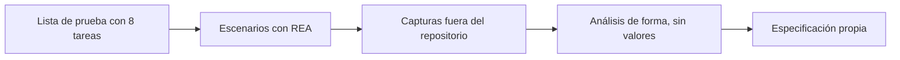

# Investigación de Andamia

Especificación propia de Andamia, escrita a partir de observar el comportamiento de la app web de TickTick con REA. Fase 1 del plan: solo investigación, sin código de la app.

## Reglas de sala limpia

| Regla | Aplicación |
|---|---|
| Sin copia de recursos | Aquí no hay código JavaScript, logotipos, iconos ni textos de TickTick |
| Redacción propia | Comportamiento descrito con palabras propias; los nombres de pantallas y campos son de Andamia |
| Sin datos personales | Las capturas crudas quedaron fuera del repositorio; aquí solo aparecen datos de prueba inventados |
| Sin servidor externo | Andamia no usará el servidor de TickTick |

## Índice

| Documento | Contenido | Cobertura |
|---|---|---|
| [pantallas.md](pantallas.md) | Inventario de pantallas y rutas de Andamia | Alta |
| [modelo-de-datos.md](modelo-de-datos.md) | Entidades y campos de Andamia | Alta en tareas; parcial en hábitos y enfoque |
| [atajos.md](atajos.md) | Mapa de atajos de teclado | Alta (solo lista; casi ninguno se probó) |
| [listas-y-bandeja.md](listas-y-bandeja.md) | Bandeja de entrada, listas, carpetas y etiquetas | Alta; carpetas sin ejercitar |
| [vistas-inteligentes.md](vistas-inteligentes.md) | Todas, Hoy, Mañana, Próximos 7 días, Resumen | Alta |
| [entrada-rapida.md](entrada-rapida.md) | Crear tareas con lenguaje natural | Alta |
| [detalle-de-tarea.md](detalle-de-tarea.md) | Fecha, prioridad, subtareas, recordatorios, repetición | Alta |
| [kanban.md](kanban.md) | Tablero por lista y por día | Media |
| [calendario.md](calendario.md) | Vistas de calendario | Baja: solo demostración |
| [matriz-eisenhower.md](matriz-eisenhower.md) | Cuadrantes de prioridad | Nula: no se pudo observar |
| [pomodoro.md](pomodoro.md) | Sesiones de enfoque | Baja: solo pantalla inicial |
| [habitos.md](habitos.md) | Hábitos y registros | Baja: sin hábitos reales |
| [busqueda-y-filtros.md](busqueda-y-filtros.md) | Búsqueda y filtros guardados | Alta en búsqueda; baja en filtros |

## Método

- **Herramienta:** REA 6.8.0 por CLI, conectado a un perfil de Chrome dedicado. El servidor MCP de REA quedó registrado, pero esta sesión no lo cargó.
- **Escenarios:** 24 capturas de navegador.
- **Auditoría de escrituras:** revisé las solicitudes de escritura de tareas, listas y orden de cada captura. Todas corresponden a la lista de prueba o a sus tareas.
- **Excepción:** la app envía por su cuenta telemetría y registro de notificaciones al cargar. No la excluí de la navegación, y no modifica tareas ni listas.

## Qué no se pudo observar

| Tema | Motivo |
|---|---|
| Calendario real | La cuenta gratuita muestra una demostración con datos de ejemplo y un aviso de pago |
| Matriz de Eisenhower | No aparece en la navegación; activarla exigía cambiar las preferencias de la cuenta |
| Filtros guardados | Función de pago |
| Cronograma | Función de pago |
| Sesión de enfoque en curso | Iniciarla habría generado datos en la cuenta |
| Hábitos en uso | Crear uno quedaba fuera de lo autorizado |
| Carpetas, restaurar desde la papelera, vista de completadas, adjuntos, comentarios, arrastrar y soltar | No se abrieron o no se ejercitaron |
| Mayoría de atajos | Se leyó su lista; solo se probó Esc |
| Rutas por análisis estático | `analyze_web_bundle` no devolvió rutas: el análisis fue parcial y la app usa rutas con `#`. Las rutas salen de la observación directa |
| Formato HAR | REA guardó las capturas en su propio formato de evidencia, así que `inspect_web_network_capture` no fue necesario |

Las fichas marcan lo no observado como **propuesta**. Conviene validarlo antes de implementarlo.

## Artefactos de la observación

| Efecto | Causa |
|---|---|
| Zona horaria distinta en algunas tareas de prueba | El navegador emulaba UTC en los primeros escenarios |
| Una tarea de prueba con título fusionado | La automatización reemplazó el texto del campo; ver [entrada-rapida.md](entrada-rapida.md) |
