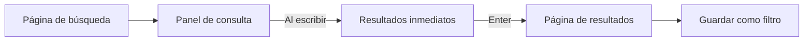

# Búsqueda y filtros

## Búsqueda (observada)

### Flujo

### Página de búsqueda

- Sin consulta, lista las tareas pendientes.
- Tiene filtros en forma de botones: lista, etiqueta, fecha, prioridad y estado.
- Un botón ofrece guardar la búsqueda como filtro.
- Al final hay un enlace para buscar también en listas archivadas.

### Panel de consulta

| Elemento | Detalle |
|---|---|
| Campo | Con botón para vaciar y cerrar |
| Ámbitos | Tarea, etiqueta, lista |
| Vacío | Ilustración con una invitación a escribir |
| Resultados | Agrupados por tipo: tareas y listas |
| Sin encontrar | Enlace para buscar en la nube |

### Reglas observadas

- Los resultados aparecen al escribir, sin pulsar Enter.
- No distingue mayúsculas.
- Busca en título y descripción; si coincide la descripción, muestra el fragmento.
- Resalta el texto coincidente.
- Incluye tareas completadas, con su estilo atenuado.
- Busca también nombres de listas. En la página de resultados solo quedaron las tareas.
- La página de resultados recuerda la consulta en la cabecera, con un lápiz para cambiarla.

La búsqueda inmediata no necesitó al servidor para mostrar resultados: la única consulta al servidor llegó al pulsar Enter y vino vacía.

## Filtros guardados (no observados)

Son de pago: al intentar crear uno aparece un aviso. Se vio solo una imagen promocional, que no se describe aquí, y el texto de ayuda de la barra lateral: filtran por lista, fecha, prioridad, etiqueta y otros criterios.

## Propuesta para Andamia

| Tema | Propuesta |
|---|---|
| Índice | Búsqueda local sobre los datos del navegador, sin servidor |
| Coincidencia | Sin distinguir mayúsculas ni acentos, para que "mañana" y "manana" coincidan |
| Filtro | Nombre y condiciones combinadas: listas, etiquetas, fechas, prioridad, tipo |
| Combinación | Con Y entre categorías y con O dentro de cada una |
| Ubicación | Sección propia en la barra lateral |
| Disponibilidad | Sin pago |

## Casos límite

| Caso | Comportamiento |
|---|---|
| Consulta sin resultados | No observado. Propuesta: mensaje con opción de quitar filtros |
| Filtro que apunta a una lista borrada | Por decidir. Propuesta: quitar esa condición y avisar |
| Caracteres especiales | No observado |
| Búsqueda en papelera | No observado. Propuesta: excluirla |

## Atajos

`/` abre la búsqueda. Ver [atajos.md](atajos.md).
