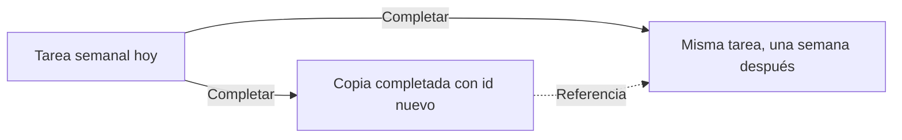

# Detalle de tarea

## Qué hace

Panel para ver y editar una tarea. Se abre a la derecha en la vista de lista y como panel flotante en el tablero.

## Partes

| Zona | Contenido |
|---|---|
| Cabecera | Casilla, fecha, prioridad |
| Cuerpo | Título, descripción o subtareas, botón para cambiar de modo |
| Pie | Lista de origen (mover), formato, comentarios, más opciones |

## Guardado

Se guarda solo, sin botón: la descripción quedó guardada segundos después de escribirla. Cada cambio envía la tarea completa con su versión, y el servidor devuelve la versión nueva.

## Completar

- La tarea pasa al grupo de completadas y se registra la fecha.
- Al desmarcar vuelve a pendiente (no probado).
- Existe un tercer estado de descarte, visto solo como icono y atajo.

## Repetición al completar

Probado con una tarea semanal:

1. Se crea una copia completada con identificador nuevo, sin repetición y enlazada a la original.
2. La original conserva su identificador y salta a la siguiente fecha.
3. La vista muestra la tarea con la fecha nueva y suma una completada.

Falta probar la repetición contada desde la fecha de finalización y el fin de una serie.

## Selector de fecha

| Elemento | Opciones |
|---|---|
| Pestañas | Fecha o duración |
| Accesos rápidos | Cuatro botones de icono; +7 es claro, el resto no se probó |
| Calendario | Mes con navegación y vuelta a hoy; el día actual resaltado |
| Hora | Lista cada 30 minutos y selector de zona horaria |
| Recordatorio | Ver abajo |
| Repetición | Ver abajo |
| Acciones | Limpiar y confirmar |

Esc descarta sin guardar: primero cierra el submenú y luego el selector.

## Recordatorios

| Tipo de tarea | Opciones |
|---|---|
| Todo el día | El mismo día, 1, 2 o 3 días antes, 1 semana antes (todas a las 09:00), personalizado |
| Con hora | Al elegir hora se propone aviso a la hora exacta |

El panel tiene aceptar y cancelar. Hay un recordatorio insistente de pago. El gratuito permite 2 por tarea; Andamia no lo limitará.

## Repetición

Diaria, semanal (día actual), mensual (fecha actual), anual, días laborables (lunes a viernes) o personalizada. Las etiquetas muestran el valor calculado desde la fecha elegida. Se guarda como regla RRULE.

## Prioridad

Cuatro niveles con bandera de color: alta, media, baja y ninguna. El color se refleja en la casilla: rojo, naranja, azul y gris.

## Subtareas

- Un botón cambia la tarea a modo lista. Cambia también el icono de la fila.
- Al cambiar se crea una primera subtarea vacía.
- Enter guarda la subtarea y prepara la siguiente.
- La descripción sigue disponible sobre las subtareas.

Falta probar completar, reordenar y volver a modo texto.

## Descripción

Editor enriquecido. Escribir `/` abre comandos; por sus iconos incluye texto, títulos de tres niveles, listas, casillas, cita, separador, adjunto, subtarea, etiqueta y enlace a tarea. No se ejercitaron.

## Casos límite

| Caso | Comportamiento |
|---|---|
| Título vacío | No observado |
| Dos cambios seguidos | No observado. Propuesta: agrupar con un retardo corto |
| Conflicto de versión | No observado; solo aplica si Andamia añade sincronización |

## Atajos

Tab+M completar, Tab+D fecha, Alt+0 a 3 prioridad, Shift+Enter subtarea. Ver [atajos.md](atajos.md).
