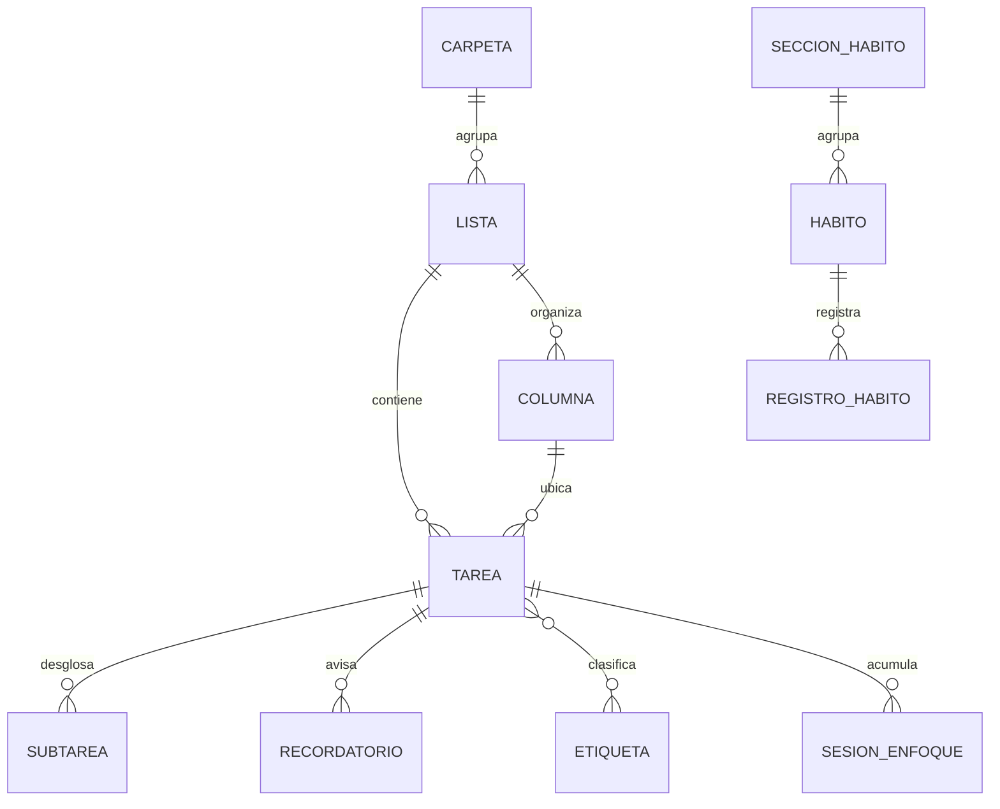

# Modelo de datos de Andamia

Modelo propio de Andamia, diseñado a partir de lo observado en el comportamiento de TickTick. Los nombres de entidades y campos son nuestros; no replican el formato de ese servicio ni su API.

Andamia no se conecta al servidor de TickTick.

**Nivel de evidencia**

| Marca | Significado |
|---|---|
| Observado | Visto en pantalla o en el tráfico de la lista de prueba |
| Parcial | Solo se vio la forma de los datos, sin ejercitar la función |
| Decisión | Elección de diseño de Andamia, no una observación |

## Entidades

## Tarea (Observado)

| Campo | Tipo | Regla |
|---|---|---|
| `id` | texto | Lo genera el cliente al crear, lo que permite crear sin conexión (Decisión) |
| `listaId` | texto | Obligatorio; sin lista elegida va a la Bandeja de entrada |
| `tipo` | `texto` \| `checklist` | Cambiar a `checklist` crea una primera subtarea vacía |
| `titulo` | texto | La entrada rápida le quita las expresiones reconocidas |
| `descripcion` | texto enriquecido | Editor con comandos al escribir `/` |
| `estado` | `pendiente` \| `completada` \| `descartada` | `pendiente` y `completada` observados; `descartada` solo por su icono (Parcial) |
| `prioridad` | `ninguna` \| `baja` \| `media` \| `alta` | Se muestra con el color de la casilla |
| `inicio`, `vence` | fecha-hora o nulo | Sin fecha, ambos son nulos |
| `todoElDia` | booleano | Verdadero si la fecha no lleva hora |
| `zonaHoraria` | texto IANA | Se guarda por tarea |
| `repeticion` | regla RRULE o vacío | Por ejemplo, semanal con intervalo 1 |
| `repetirDesde` | `vencimiento` \| `completado` | Parcial: solo se vio un valor, y este significado es una inferencia |
| `exclusiones` | lista de fechas | Parcial: siempre vacía en lo observado |
| `etiquetas` | lista de textos | Se guardan normalizadas en minúsculas |
| `orden` | entero | Valores menores van primero; cada tarea nueva queda arriba |
| `columnaId` | texto o nulo | Solo aplica a Kanban (Parcial) |
| `padreId`, `hijosIds` | texto, lista | Tareas anidadas (Parcial) |
| `completadaEn` | fecha-hora o nulo | Se fija al completar |
| `creadaEn`, `modificadaEn` | fecha-hora | Las fija el cliente |
| `version` | texto | Lo devuelve el servidor en cada cambio y se reenvía al editar; sirve para detectar conflictos si Andamia añade sincronización (Decisión) |

## Subtarea (Observado)

| Campo | Tipo | Regla |
|---|---|---|
| `id` | texto | Generado por el cliente |
| `titulo` | texto | Puede estar vacío al crearse |
| `estado` | `pendiente` \| `completada` | Parcial: solo se vio `pendiente` |
| `orden` | entero | |

Se guarda dentro de la tarea.

## Recordatorio (Observado)

| Campo | Tipo | Regla |
|---|---|---|
| `id` | texto | Generado por el cliente |
| `desplazamiento` | duración ISO 8601 | Tiempo relativo al vencimiento; cero avisa a la hora exacta |

Una tarea con hora recibió un recordatorio a la hora exacta sin pedirlo; una tarea de todo el día no recibió ninguno.

## Lista (Observado)

| Campo | Tipo | Regla |
|---|---|---|
| `id` | texto | |
| `nombre` | texto | Máximo 64 caracteres |
| `color` | color o nulo | Sin color por defecto |
| `carpetaId` | texto o nulo | |
| `tipo` | `tareas` \| `notas` | El formulario ofrece un selector; `notas` no se ejercitó (Parcial) |
| `vista` | `lista` \| `kanban` \| `cronograma` | Se guarda por lista |
| `incluirEnTodas` | booleano | Controla si aparece en las listas inteligentes |
| `orden` | entero | |
| `silenciada` | booleano | Parcial |

## Carpeta (Parcial)

`id`, `nombre`, `orden`. La cuenta no tenía carpetas, así que solo se vio el selector en el formulario de lista.

## Etiqueta (Observado)

| Campo | Tipo | Regla |
|---|---|---|
| `nombre` | texto | Clave en minúsculas |
| `nombreVisible` | texto | Conserva las mayúsculas |
| `color` | color | |
| `orden` | entero | |
| `etiquetaPadre` | texto o nulo | Decisión, por confirmar: no se observó anidamiento |

## Columna de Kanban (Parcial)

`id`, `listaId`, `nombre`, `orden`.

## Hábito (Parcial)

La cuenta no tenía hábitos, y crear uno quedaba fuera de lo autorizado. Propuesta de Andamia (Decisión):

| Entidad | Campos |
|---|---|
| Hábito | `id`, `nombre`, `icono`, `color`, `seccionId`, `repeticion`, `metaDiaria`, `unidad`, `recordatorios`, `archivado`, `orden` |
| Sección de hábito | `id`, `nombre`, `orden` (forma observada) |
| Registro de hábito | `id`, `habitoId`, `fecha`, `valor`, `estado` |

## Sesión de enfoque (Parcial)

La cuenta no tenía sesiones y no se inició ninguna para no generar datos. Propuesta de Andamia (Decisión):

| Campo | Tipo | Regla |
|---|---|---|
| `id` | texto | |
| `tipo` | `pomodoro` \| `cronometro` | La pantalla ofrece ambos modos |
| `inicio`, `fin` | fecha-hora | |
| `pausas` | lista de intervalos | |
| `tareaId` | texto o nulo | |
| `nota` | texto | |

## Preferencias (Observado)

Zona horaria, primer día de la semana, hora de aviso por defecto, prioridad y fecha por defecto, criterio de orden por vista, mostrar u ocultar completadas, visibilidad de cada lista inteligente, pestañas de navegación activas y activación de la entrada en lenguaje natural.

## Diferencias en el MVP

El código de la Fase 2 implementa una parte de este modelo. Los tipos reales están en `src/modelos/tipos.ts`.

| Tema | MVP |
|---|---|
| `tipo` | No existe: toda tarea puede tener notas y subtareas a la vez |
| `inicio` | No existe: solo `vence`, como fecha sola si es de todo el día o como fecha y hora si lleva hora |
| `eliminadaEn` | Campo nuevo para el borrado suave |
| Repetición, recordatorios y columnas | Implementados en la Fase 3, con los campos `repeticion`, `repetirDesde`, `repetidaDe`, `recordatorios`, `avisosEnviados` y `columnaId` |
| `exclusiones` | No existe: aún no se puede saltar una ocurrencia concreta |
| `descartada`, tareas anidadas, `version` | Aún no implementados |
| Hábitos y sesiones de enfoque | Aún no implementados |

## Decisiones de diseño para Andamia

| Tema | Decisión |
|---|---|
| Identificadores | Los genera el cliente |
| Persistencia | Local primero, según el plan aprobado |
| Sincronización | Fuera del alcance inicial; se conservan `version` y `modificadaEn` para añadirla después |
| Límites de plan | Sin límites artificiales de listas, tareas o subtareas |
| Vistas de calendario | Se implementan a partir de la especificación propia, porque en esta cuenta solo se vio una demostración |
