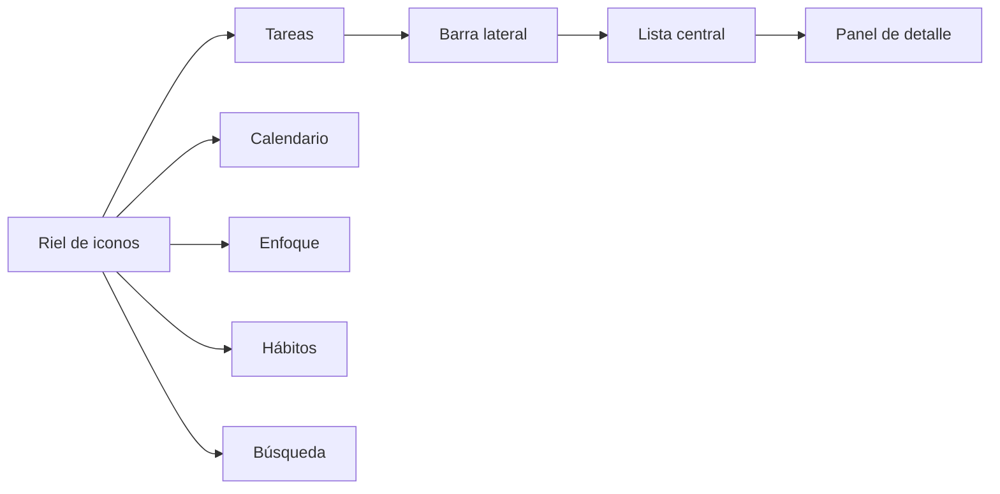

# Pantallas de Andamia

Inventario basado en lo observado. Los nombres y las rutas son de Andamia.

## Estructura general

La pantalla de tareas tiene tres columnas: barra lateral, lista central y detalle. El riel izquierdo cambia entre módulos y también da acceso a perfil, sincronización, notificaciones y ayuda.

## Inventario

| Pantalla | Ruta en Andamia | Contenido | Observado |
|---|---|---|---|
| Todas las tareas | `/tareas/todas` | Tareas agrupadas por fecha | Sí |
| Hoy | `/tareas/hoy` | Tareas con fecha de hoy | Sí |
| Mañana | `/tareas/manana` | Tareas con fecha de mañana | Sí |
| Próximos 7 días | `/tareas/semana` | Lista o columnas por día | Sí |
| Bandeja de entrada | `/tareas/bandeja` | Tareas sin lista elegida | Parcial |
| Lista | `/listas/:id/lista` | Tareas de una lista | Sí |
| Tablero de lista | `/listas/:id/tablero` | Columnas de una lista | Sí |
| Tarea abierta | `…/:tareaId` | Agrega el detalle a la vista actual | Sí |
| Etiqueta | `/etiquetas/:nombre` | Tareas con esa etiqueta | No |
| Resumen | `/resumen` | Informe del periodo | Sí |
| Completadas | `/tareas/completadas` | Historial | No |
| Papelera | `/tareas/papelera` | Tareas borradas | Parcial |
| Calendario | `/calendario/:modo` | Día, semana, mes, año, agenda | Demostración |
| Matriz | `/matriz` | Cuatro cuadrantes | No |
| Enfoque | `/enfoque` | Temporizador y estadísticas | Parcial |
| Hábitos | `/habitos` | Franja semanal y lista | Parcial |
| Búsqueda | `/buscar` | Panel y página de resultados | Sí |
| Ajustes | `/ajustes` | Preferencias | No |

## Diálogos y menús

| Elemento | Se abre desde | Observado |
|---|---|---|
| Crear lista | Botón añadir de la sección de listas | Sí |
| Confirmar borrado de lista | Menú contextual de la lista | Sí |
| Menú contextual de lista | Clic derecho en la barra lateral | Sí |
| Menú de vista de lista | Botón de opciones de la cabecera | Sí |
| Agrupar y ordenar | Botón de orden de la cabecera | Sí |
| Selector de fecha | Fecha del detalle | Sí |
| Menú de prioridad | Bandera del detalle | Sí |
| Crear hábito | Botón añadir de hábitos | Sí |
| Panel de búsqueda | Lápiz de la página de búsqueda | Sí |
| Atajos de teclado | Menú de ayuda | Sí |

## Barra lateral

| Sección | Contenido |
|---|---|
| Listas inteligentes | Todas, Hoy, Próximos 7 días, Bandeja, Resumen, con contador de pendientes |
| Listas | Listas propias, o un texto de ayuda si no hay ninguna |
| Filtros | Filtros guardados, o un texto de ayuda si no hay ninguno |
| Etiquetas | Con punto de color y contador |
| Sistema | Completadas y Papelera |

Cada lista inteligente puede ocultarse desde su propio menú.

## Comportamientos de navegación

- Al abrir una tarea, su identificador se agrega a la ruta, así que el enlace lleva directo a ella.
- Cada lista recuerda su modo de vista. Si está en tablero, pedir la ruta de lista redirige al tablero.
- Un diálogo modal permanece visible al cambiar de ruta. En Andamia, cada cambio de ruta debe cerrarlo.

## Rutas de la app observada

Solo como referencia de la estructura:

| Patrón | Uso |
|---|---|
| `#q/<lista-inteligente>/<modo>` | Listas inteligentes |
| `#p/<id>/<modo>/<tarea>` | Lista propia, con tarea opcional |
| `#c/all/calendar/<m,w,d,a>` | Calendario |
| `#focus`, `#s` | Enfoque y búsqueda |
