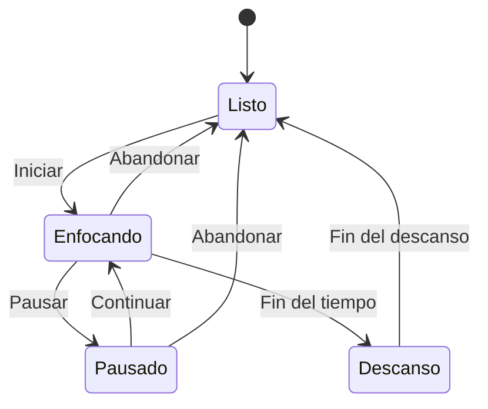

# Pomodoro y enfoque

**Cobertura baja.** Solo se vio la pantalla inicial. No se inició ninguna sesión para no generar datos en la cuenta.

## Observado

| Elemento | Detalle |
|---|---|
| Modos | Pomodoro y cronómetro |
| Temporizador | Círculo con 25:00 por defecto |
| Control | Botón de inicio |
| Tarea vinculada | Selector sobre el círculo |
| Acciones de cabecera | Añadir y opciones |
| Resumen | Pomodoros de hoy, enfoque de hoy, pomodoros totales, duración total |
| Registro | Lista de sesiones con botón para añadir a mano; estado vacío si no hay |

Los datos de una tarea incluyen un resumen de enfoque por tarea. Hay un límite de temporizadores por plan.

## Propuesta para Andamia

| Regla | Propuesta |
|---|---|
| Duraciones | 25 minutos de enfoque y 5 de descanso, configurables |
| Descanso largo | Cada cuatro sesiones |
| Guardado | Una sesión se guarda al terminar; abandonar pide confirmación |
| Tarea vinculada | Opcional; suma tiempo a la tarea |
| Tiempo real | Calcular con la hora de inicio, no con un contador, para que siga correcto con la pestaña en segundo plano |
| Registro manual | Con inicio, fin, tarea y nota |
| Aviso | Sonido y notificación al terminar |

## Casos límite por decidir

| Caso | Propuesta |
|---|---|
| Recargar durante una sesión | Recuperarla del almacenamiento local |
| Equipo suspendido | Marcar la sesión como terminada a su hora prevista |
| Sesión muy corta | No registrar las de menos de un minuto |
| Completar la tarea en curso | Preguntar si termina la sesión |

## Atajos

Ctrl+Shift+P inicia o pausa. Ver [atajos.md](atajos.md).
